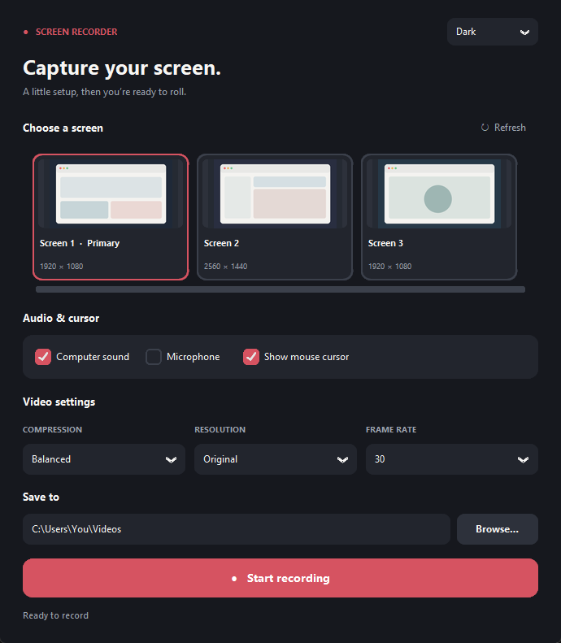
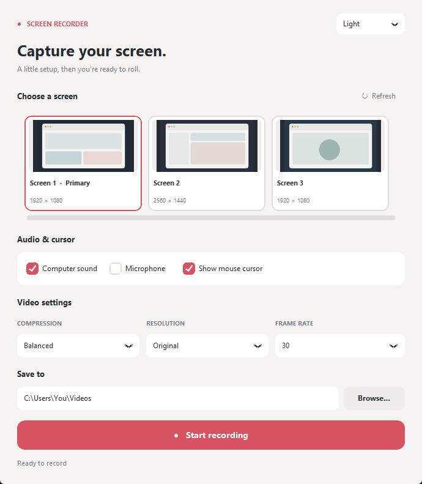

# Simple Screen Recorder

A straightforward Windows screen recorder for capturing one display at a time. Select a thumbnail, choose your audio and video settings, and record to an MP4 file.

## A closer look

The app follows your Windows theme, or you can choose light or dark. Screen previews below are illustrative examples.

| Dark mode | Light mode |
| --- | --- |
|  |  |

## Install on Windows

1. Download [Simple-Screen-Recorder-Setup.exe](https://github.com/kingrebelf/Simple-screen-recorder/raw/refs/heads/main/installer/Simple-Screen-Recorder-Setup.exe). On the GitHub file page, use **Download raw file** if needed.
2. Open the downloaded installer and follow its instructions. It installs for the current Windows user and does not require Python or FFmpeg to be installed separately.
3. Open **Simple Screen Recorder** from the Start menu. You can also create a desktop shortcut during setup.

The installer is unsigned, so Windows SmartScreen may display a warning. To uninstall, use **Settings → Apps → Installed apps → Simple Screen Recorder → Uninstall**.

## Record a video

1. Click the preview of the screen you want. Click **Refresh previews** to update the thumbnails or detect newly connected screens.
2. Choose **Computer sound**, **Microphone**, both, or neither. These use your current default Windows playback and microphone devices; set those in Windows before recording.
3. Turn **Show mouse cursor** on or off. When off, your cursor stays visible while you use Windows but is omitted from the video. Choose a compression preset, output resolution, and frame rate. **Original** uses the display's resolution. The 1080p, 1440p/2K and 2160p/4K options are maximum dimensions; smaller displays are not enlarged. Aspect ratio is preserved.
4. Choose a save folder and click **Start recording**, then **Stop recording** when finished. Wait until the app confirms the MP4 has been saved before closing it.

The app follows the Windows light/dark setting by default; use the theme menu to select Light or Dark instead. Smaller compression presets and lower resolutions or frame rates generally produce smaller files. Exact file size depends on what is on screen. 60 fps and 4K require more processing power and storage. Audio and video are combined after recording, so allow time and temporary disk space for long recordings. Protected video content may appear blank.

## Build from source

Use 64-bit Windows, Python 3.11, FFmpeg with `gdigrab` and `libx264` available on `PATH`, and Inno Setup 6. An FFmpeg distribution with its `LICENSE` file alongside the `bin` directory is required when building the installer.

```powershell
py -3.11 -m pip install -r requirements.txt
py -3.11 app.py
```

To create an installer, run `powershell -ExecutionPolicy Bypass -File .\build.ps1`. The installer is written to `installer\Simple-Screen-Recorder-Setup.exe`. Building replaces any installer at that path.

## Third-party components

The packaged installer includes FFmpeg, Python, SoundCard, SoundFile, Pillow, NumPy and CustomTkinter. The FFmpeg distribution's license is included in the installed application folder. The bundled FFmpeg essentials build is provided by [gyan.dev](https://www.gyan.dev/ffmpeg/builds/); its build instructions and corresponding source references are linked there. FFmpeg is licensed under the GPL for this build.

